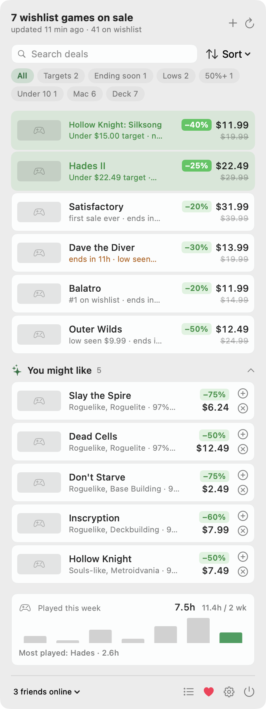

# Steamwatch

[](https://github.com/mrte1122/Steamwatch/actions/workflows/build.yml)
[](https://ko-fi.com/mrte90)


A macOS menu-bar app that watches your Steam wishlist for sales. The menu bar shows how many
wishlisted games are discounted right now; the dropdown lists them (target hits first, then
first-ever sales and new lows), tracks the lowest price seen for each, shows your playtime this
week, and tells you which friends are online. It notifies you when a game drops to the price you
set.



## Install

**[Download Steamwatch for macOS](https://github.com/mrte1122/Steamwatch/releases/latest/download/Steamwatch.zip)**
(macOS 14 or later, Apple silicon and Intel). Unzip it, drag **Steamwatch.app** into **Applications**, then open it.
It's signed and notarized, and updates itself.

Or with [Homebrew](https://brew.sh):

```bash
brew trust mrte1122/tap
brew install --cask mrte1122/tap/steamwatch
```

Recent Homebrew versions only load casks from third-party taps you've trusted, hence the first line; you only need it once.

## Setup

1. Launch Steamwatch. If Steam is installed on this Mac, the popover offers **Use <your name>**:
   Steamwatch reads the signed-in account from Steam's local `loginusers.vdf` (nothing is sent
   anywhere) and you're done with this step. Otherwise Settings opens on first run.
2. Or, in Settings, paste your Steam profile URL (`https://steamcommunity.com/profiles/7656…` or
   `https://steamcommunity.com/id/yourname`) and click Connect.
3. Your wishlist must be public: on Steam, Profile → Edit Profile → Privacy Settings → set
   **Game details** to Public. The wishlist and store prices are read without signing in.
4. Optional: paste a [Steam Web API key](https://steamcommunity.com/dev/apikey) to unlock playtime
   and friends online. Steam issues one to any account that has made a purchase. The key is stored in
   your Keychain and only ever sent to `api.steampowered.com`.

To watch a game that isn't on your wishlist, press **+** in the popover, search the Steam store,
and click **Watch**. You can give it a price limit; you're notified the moment it's at or under that
price, whether through a sale or a permanent price cut. Watched games are checked on every
refresh alongside your wishlist and listed in Settings → Watching.

For the whole wishlist at once, turn on **Settings → Deal rule**: "tell me about any watched game
that's at least 75% off, rated 85%+, under $20" (each part adjustable). Matches show under the
**Picks** chip and notify as new deals appear.

**You might like** suggests discounted games that aren't on your wishlist but fit it. Steamwatch
reads the store tags of your wishlisted games (ignoring broad ones like "Indie" or "Singleplayer",
and counting the games you've ranked highest double), asks Steam for discounted games under your
top tags, and keeps the best-reviewed fits (85%+ positive from 500+ reviews). Click **+** to watch
one or **✕** for "not interested". It checks twice a day; with a Web API key, games you own are
skipped. Turn it off in Settings → General.

Right-click a deal for **Notify Me At** (25/50/75% off or the lowest seen, in one click),
**Mute Notifications** (it stays in the list but never alerts) or **Hide (Bought It)**. Deal
notifications carry the same Hide and Mute buttons. Settings → Notifications → **Quiet hours**
holds alerts overnight and delivers them together afterwards.

Keyboard: ⌘F search, ↑/↓ move through deals, Return opens one, Esc backs out (clears the
search, then the filter, then closes), ⌘N watch a game, ⌘R refresh, ⌘, Settings.

Click a game to open its store page, in the Steam app if it's installed (Settings → Menu bar →
Open games in the Steam app), otherwise in your browser. Right-click it to set a target price (or "Set Target to
$X" for the current sale price) or to hide it once you've bought it; hidden games stay out of the
list until they leave your wishlist. Settings lists every target and hidden game. With more than
a few deals the list gets a search field, a sort menu (Best match, Highest rated, Biggest
discount, Cheapest, Ending soonest, Name) and filter chips (Targets, Ending soon, Lows, 50%+, Under 10, Mac, Deck; empty ones are hidden), and scrolls past six rows. "Highest rated" uses Steam's review percentage, weighted down a
little for games with under 500 reviews; "Deck" means Verified or Playable.

## How the numbers work

- **On sale** means the store reports a discount on the app's best purchase option in your
  country (Settings → Store → Country code).
- **Low seen / new low** compare against what Steamwatch itself has observed. Steam has no price
  history API, so the record starts the first time the app looks at a game.
- **First sale ever** means every earlier reading of that game was at full price.
- **Order**: target hits, then first sales, then new lows, then everything else by score. Score
  is the discount percent plus a boost for games you ranked near the top of your wishlist (+60 for
  #1, two less per rank, nothing past #30), so a −30% on a top-five game outranks a −90% on
  something you added years ago. Rank your wishlist on Steam to steer it.
- **Big Steam sales** have no name in Steam's API, so Steamwatch infers one: when at least 1 in 20
  of your wishlisted games (minimum 8) goes on sale in a single refresh, the popover shows a "Big
  Steam sale" banner with how many extra games are discounted and when most of the discounts end.
  The banner clears once the count falls back near where it was.
- **Notifications** for target prices always post one by one (up to three per refresh). Other
  alerts (new lows, first sales) post individually only when there are a few; a burst of four or
  more, or any during a big sale, becomes a single digest like "Steam sale: 312 wishlist games on
  sale · 4 under target · 37 first sales · most end in 6d".
- **Freshness**: besides the timer, Steamwatch refreshes when your Mac wakes or the network comes
  back, if the last reading is more than five minutes old.
- **Played this week** samples Steam's "last two weeks" counter on every refresh and attributes
  each increase to the day it was noticed, so the daily bars fill in while the app is running.
  Until there is a week of samples it also shows the raw two-week total.

## Building

Requires Xcode 15 or newer (macOS 14+ to run).

```bash
swift test                                   # core library tests
./scripts/build-app.sh --install             # universal Steamwatch.app → ~/Applications
```

Useful flags on the built binary:

```bash
build/Steamwatch.app/Contents/MacOS/Steamwatch --once          # fetch once and print a summary
build/Steamwatch.app/Contents/MacOS/Steamwatch --once --demo   # same with sample data
build/Steamwatch.app/Contents/MacOS/Steamwatch --search "hades"   # the store search, printed
build/Steamwatch.app/Contents/MacOS/Steamwatch --suggest           # fetch and print suggestions
build/Steamwatch.app/Contents/MacOS/Steamwatch --snapshot docs --demo   # README screenshots
```

Launch with `--demo` to see the UI with sample data and no network access.

## Updates and releases

Steamwatch checks GitHub Releases once a day (Settings → About to turn that off or check now) and
installs in place. Each release ships `Steamwatch.zip` and `Steamwatch.zip.sig`; the app installs
only a zip whose Ed25519 signature matches the public key compiled into `Updater.swift`, whose
bundle ID and version match, and that's signed by the same Developer ID team as the running copy.

To publish (maintainer only):

```bash
./scripts/release.sh 0.2.0 "What changed"
```

That bumps `VERSION`, builds, notarizes, signs the zip with the private key at
`~/.config/steamwatch/update-signing-key` (never committed), tags, pushes, creates the GitHub
release, and bumps `Casks/steamwatch.rb` in `mrte1122/homebrew-tap` if it exists. Lose the private
key and existing installs can no longer auto-update.

`Steamwatch --check-update` / `--update` do the same check and install from the terminal.

## Project layout

```
Sources/SteamwatchCore   Foundation-only library: Steam client, deal engine, price history,
                         playtime log, formatting, JSON file formats. Builds on Linux/Windows.
Sources/Steamwatch       macOS app: NSStatusItem + NSPopover, SwiftUI views, Keychain,
                         UserNotifications, Settings window.
Tests/SteamwatchCoreTests
scripts/build-app.sh     universal build, signing, notarization, zip
scripts/release.sh       version bump, signed zip, tag, GitHub release, Homebrew cask bump
scripts/sign-update.swift  Ed25519 key generation and update signing
docs/windows.md          what a Windows port needs
```

Data lives in `~/Library/Application Support/Steamwatch/` (`price-history.json`,
`playtime.json`, `targets.json`, `watchlist.json`, `suggestions.json`, `hidden.json`, `sale-event.json`, `cache.json`). Preferences are in
`io.github.mrte1122.Steamwatch`.

## Steam API usage

| Call | Key | Used for |
| --- | --- | --- |
| `IWishlistService/GetWishlist` | no | wishlist app IDs |
| `store.steampowered.com/api/storesearch` | no | the + panel's store search |
| `IStoreQueryService/Query` | no | discounted games by tag, for suggestions (twice a day) |
| `IStoreService/GetTagList` | no | tag names for suggestion reasons |
| `IPlayerService/GetOwnedGames` | yes | skip owned games in suggestions |
| `IStoreBrowseService/GetItems` | no | names, capsule art, prices, sale end dates, review summary, platforms (50 apps per request) |
| `IPlayerService/GetRecentlyPlayedGames` | yes | playtime |
| `ISteamUser/GetPlayerSummaries` | yes | your status, friends' status and current game |
| `ISteamUser/GetFriendList` | yes | friend IDs (public friends lists only) |
| `ISteamUser/ResolveVanityURL` | yes | custom profile URLs → SteamID64 |

Default refresh is every 30 minutes: 1 wishlist call plus one store call per 50 wishlisted games,
and 3 keyed calls when a key is set. Rate limits, 5xx responses and dropped connections are retried
twice (after 2 s and 6 s). If a store batch still fails, the other batches are kept and the missing
games keep their last known prices (the header then says "N stale"); after a rate limit the
remaining batches are skipped and the app waits 5 minutes, doubling up to 40, before trying again.
Any failed refresh retries at 2, 4, 8, 16 then 30 minute intervals until one succeeds, and the
popover keeps showing the last good reading throughout. The Refresh button overrides a cooldown.
Steam is not affiliated with this project.

## License

MIT. Steamwatch is free; if it saves you money on a sale, you can [buy me a coffee on Ko-fi](https://ko-fi.com/mrte90).
